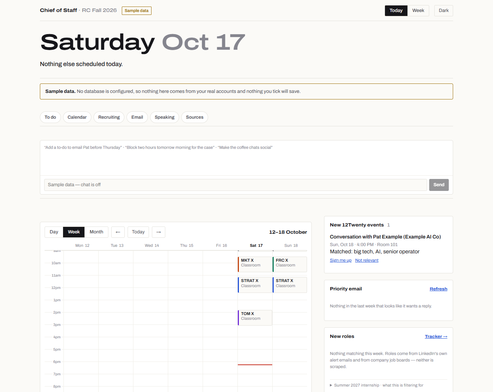

# HBS Chief of Staff — template

One private web page that shows your classwork, calendar and recruiting together, plus a
small worker on your laptop that keeps it fed and an assistant you can ask to move things
around. Built by Jamie Friedman (HBS MBA 2028) during the RC year, with Claude Code, and
shared as a template so you can build your own copy. **Nothing in here is anyone's real
data** — every name, company and course ID is an example for you to replace.

Single user. No accounts, no sharing, no multi-tenancy. Your copy is yours alone.



## What you get

| Feature | Where it comes from |
|---|---|
| **Today / Week calendar** with drag-to-move | Google Calendar (API) + HBS Outlook (browser session), reconciled so either can be used |
| **To-do list** — case prep, problem sets, your own tasks | Canvas assignments (API) + anything you add |
| **Class prep** — prep questions, links, optional Google Docs | Canvas, optionally Google Drive |
| **Participation** — sessions since you last spoke, per course | An Excel "Class Log" you keep (optional) |
| **Recruiting** — events, deadlines, registrations | 12Twenty (browser session) and Gmail |
| **Career tracking** — internships tracker, new roles, people to reach out to | `/internships`, job boards, Gmail alerts, your `lib/targets.json` |
| **Action queue** — the worker proposes, you approve with one tap | Registering for a 12Twenty event, adding to both calendars, … |
| **Built-in assistant** — "move my FRC prep to tonight", "add a to-do…" | Claude, with **your own** Anthropic API key |

## Shape

Two halves, because the data sources are not equally reachable.

- **The web app** (`app/`, `lib/`) — Next.js on Vercel, reading a Neon Postgres database.
  It never talks to Canvas, Google or Outlook itself.
- **The worker** (`worker/`) — Node on your laptop, plus a cloud half on GitHub Actions
  (`.github/workflows/sync.yml`). Canvas and Google run over APIs (cloud and laptop);
  Outlook and 12Twenty run over a Playwright browser session (laptop only). It writes
  straight into the database and carries out actions you have approved.

If the laptop is closed, browser-sourced data goes stale — every source shows its last
sync time and the page shows a worker heartbeat. Stale data announces itself.

## Make it yours: two files

1. **`lib/profile.json`** — your name, section, courses (and their Canvas course codes),
   HBS and personal email, Canvas base URL, time zone, optional participation tracker.
2. **`lib/targets.json`** — your recruiting filter: functions in priority order,
   industries, cities, and what to exclude. It ranks roles, 12Twenty events and people.

Optional: `data/internships.json` + `data/keywords.json` seed the internships tracker
(`node scripts/import-watchlist.mjs`).

Keep your GitHub repository **private** — these two files describe you. When you click
**Use this template → Create a new repository**, choose **Private**; GitHub does not pick
it for you.

Optional: if you keep class-prep write-ups on disk (`02 Courses/<COURSE>/Class Material/…
- Prep.docx`, as the daily study bot makes them), set `HBS_ROOT` in `.env.local` to the
folder that holds `02 Courses`, and the worker attaches them to the matching class to-dos.
Unset, that source is simply skipped.

## Build this with Claude Code

You do not need to be an engineer. Open this folder in Claude Code and work through it
together:

1. **Pause OneDrive sync** if the folder is inside OneDrive (see gotchas), then ask Claude:
   *"Read README.md and docs/, then help me set this up step by step. Start by filling in
   lib/profile.json and lib/targets.json with me."*
2. Let it walk you through [`docs/neon-setup.md`](docs/neon-setup.md),
   [`docs/google-setup.md`](docs/google-setup.md) and [`docs/deploy.md`](docs/deploy.md)
   in that order. Do the clicking in the browser yourself; let Claude do the files.
3. Paste secrets into `.env.local` yourself (`node scripts/set-secret.mjs NAME` prompts
   for a value without echoing it). Don't paste tokens into the chat.
4. Ask Claude to run `npm run verify` after any change — it lints, typechecks and builds.
5. Want a feature changed? Describe it. `docs/spec.md` explains how the pieces fit, and
   the code comments explain *why* things are the way they are — read them before
   "simplifying" something.

## Setup, in order

```bash
winget install OpenJS.NodeJS.LTS
```

Then, in the project folder (**OneDrive sync paused**):

```bash
npm install
npx playwright install chromium
cp .env.example .env.local
```

(`cp` is for Git Bash, macOS and Linux; in Windows Command Prompt or PowerShell use
`copy .env.example .env.local`.)

Before the first `npm run dev`, set two values in `.env.local`. The page is behind a login
even on your own laptop, so without them it redirects to `/login` and signing in fails:

- `APP_PASSWORD` — the password you will type to open the console. Make it long.
- `SESSION_SECRET` — signs the login cookie. A long random string.

This prints a suitable random string; run it once per value:

```bash
node -e "console.log(require('crypto').randomBytes(32).toString('base64'))"
```

Or let `node scripts/set-secret.mjs APP_PASSWORD` (and `SESSION_SECRET`) prompt for each
without echoing it.

| Step | Command / doc |
|---|---|
| 1. Fill in `lib/profile.json` and `lib/targets.json` | by hand, or with Claude |
| 2. Database | [`docs/neon-setup.md`](docs/neon-setup.md), then `npm run db:push` |
| 3. Try it locally | `npm run dev` → <http://localhost:3000>, sign in with `APP_PASSWORD`. Before `DATABASE_URL` is set it shows sample data; after, your (empty) database |
| 4. Canvas token | hbs.instructure.com → Account → Settings → New Access Token → `CANVAS_TOKEN`; check with `npm run canvas:check` |
| 5. Google Calendar / Gmail | [`docs/google-setup.md`](docs/google-setup.md), then `npm run worker:google-auth` |
| 6. HBS Outlook | `npm run worker:outlook-login` (sign in once in the window it opens) |
| 7. 12Twenty | `npm run worker:12twenty-login` |
| 8. Run the worker | `npm run worker` (leave it running; `worker/start-worker.cmd` can start it at logon) |
| 9. Deploy | [`docs/deploy.md`](docs/deploy.md) — Vercel vars `DATABASE_URL`, `APP_PASSWORD`, `SESSION_SECRET`, `WORKER_TOKEN`, plus `ANTHROPIC_API_KEY` for the assistant |
| 10. Cloud sync (optional) | GitHub → Settings → Secrets → Actions, per the header of `.github/workflows/sync.yml` |

## The assistant

The chat box (`app/AgentChat.tsx` → `app/api/agent/route.ts`) calls Claude with tools to
add to-dos, place work on the calendar, move events and queue 12Twenty registrations.
It runs on **your own** key: create one at
[console.anthropic.com](https://console.anthropic.com) → API Keys, and set
`ANTHROPIC_API_KEY` in Vercel (and in `.env.local` to use it locally — the worker also
uses it to estimate how long each to-do will take). You pay Anthropic directly for what
you use; set a monthly spend limit in the console. Without a key, everything else works
and the chat says it is not configured. To add a tool, add a definition and a case in
`runTool` in the route — the existing ones are the pattern.

## Hard-won gotchas

- **HBS Google accounts cannot create Google Cloud projects.** Use a personal Gmail for
  the Cloud project and the OAuth client.
- **Add yourself as a test user** (Google Auth Platform → Audience → Test users), or
  sign-in fails with `Error 403: access_denied`.
- **Tokens expire every seven days while the app is in Testing.** The page raises a
  banner; run `npm run worker:google-auth` again (and update the GitHub secret with
  `npm run google:copy-token` if you use the cloud sync). Publishing doesn't fix this
  cheaply — see google-setup.md.
- **Pause OneDrive sync before `npm install`** (and before `npm run build`). Sync holds
  file locks that break installs half-way. `npm run dev`/`build` also move `.next` out of
  OneDrive automatically (`scripts/unsync-build.mjs`).
- **Go easy on 12Twenty.** It sits behind bot protection that fingerprints the browser.
  The worker visits every three hours, never headless, and never clicks through a
  challenge. If it shows a bot check, run `npm run worker:12twenty-login` and complete it
  by hand once. Don't shorten the interval.
- **Never scrape LinkedIn.** Automating your logged-in LinkedIn breaks their terms and
  risks restricting the account you are recruiting with. LinkedIn signal arrives only as
  the alert emails LinkedIn sends you (via Gmail), and "people to reach out to" are search
  links for *you* to click.
- **Never test against your live cookie store.** Your signed-in Outlook and 12Twenty
  browser profiles live outside the repo, in `%LOCALAPPDATA%\hbs-chief-of-staff\`
  (`outlook-profile`, `twelvetwenty-profile`) — outside OneDrive, because a synced
  Chromium profile cannot hold its lock file. Experiments, debugging scripts and Playwright
  tests should use a throwaway copy or a fresh profile — a bot challenge, a corrupted
  profile or a sign-out there takes the real worker down with it.
- **No writes back to Canvas.** Read-only, always. Ticking a mirrored task off is local.
- **Nothing acts on your behalf without approval.** Registrations and calendar writes go
  through the action queue. The console never sends email: it can draft outreach, and
  there is no sending code at all (`EMAIL_SEND_ENABLED` in `.env.example` is reserved for
  a future send path and does nothing today).
- **Secrets never reach Vercel or git** except the few listed in docs/deploy.md. Browser
  sessions stay in `%LOCALAPPDATA%\hbs-chief-of-staff\`, the Google token in
  `worker/.credentials/`; `worker/.sessions/` only holds diagnostic probe files. All are
  outside git.
- `origin` on a task is load-bearing: `mirrored` rows belong to a source system and are
  overwritten on sync; `owned` rows are yours and are never touched.

## Commands

| Command | What it does |
|---|---|
| `npm run dev` | Local web app on port 3000. Needs `APP_PASSWORD` and `SESSION_SECRET` in `.env.local`; shows sample data until `DATABASE_URL` is set |
| `npm run verify` | Lint + typecheck + production build |
| `npm run db:push` / `db:check` | Apply `db/schema.sql` (safe to re-run) / report on the database |
| `npm run worker` | The laptop worker loop |
| `npm run worker:once` | One pass of Canvas, Outlook and Google Calendar plus reconcile, then exit (a quick check; `npm run worker` runs everything) |
| `npm run worker:google-auth` | Connect (or reconnect) Google |
| `npm run worker:outlook-login` | Sign in to HBS Outlook once |
| `npm run worker:12twenty-login` | Sign in to 12Twenty once / clear a bot check |
| `npm run canvas:check` | Check the Canvas token and list your course codes |
| `npm run google:copy-token` | Copy the Google refresh token to the clipboard for the GitHub secret |

Full specification: [`docs/spec.md`](docs/spec.md).
